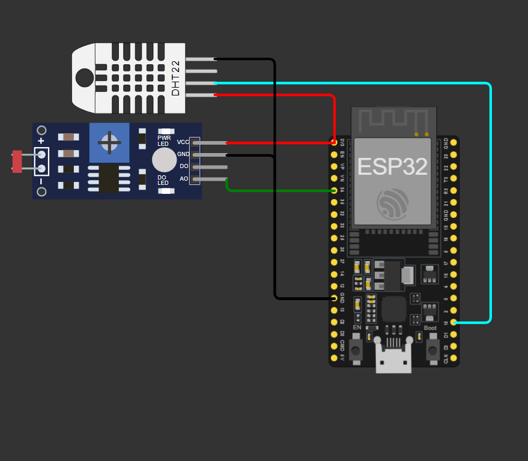

# Vinheria Agnello: Monitoramento com ESP32 e MQTT

## **Checkpoint 05: Edge Computing & Computer Systems**
FIAP | Engenharia de Software | 2026 | Professor Lucas D. Augusto

**Simulação online (Wokwi):** https://wokwi.com/projects/478642838445282305

---

## O que é esse projeto?

Evolução do Checkpoint 01 (Arduino + LDR). Agora o sistema da Vinheria Agnello virou IoT: um **ESP32** lê temperatura, umidade e luminosidade da adega e manda os dados pela internet via **Wi-Fi** usando o protocolo **MQTT**. O aplicativo **MyMQTT** recebe os dados (leitura) e também consegue mandar mensagens pro ESP32 (escrita). Tudo simulado no **Wokwi**.

Cada leitura sai com **timestamp** (horário de Brasília), como pede o enunciado.

| Sensor | Grandeza | Pino no ESP32 |
|--------|----------|---------------|
| DHT22  | Temperatura e umidade | GPIO 15 |
| LDR (módulo) | Luminosidade | GPIO 34 |

---

## Links

- Simulação no Wokwi: https://wokwi.com/projects/478642838445282305
- Repositório: https://github.com/dudsbtw/cp5-edge-rfeb
- Checkpoint 01 (base): https://github.com/dudsbtw/cp1-edge-rfeb
- Vídeo de demonstração: (colar o link aqui)

---

## Componentes utilizados

- 1x ESP32 DevKit
- 1x Sensor DHT22
- 1x Módulo LDR (pinos VCC, GND, DO e AO)

---

## Como montar

| Componente | Pino do componente | Pino do ESP32 |
|------------|--------------------|---------------|
| DHT22 | VCC | 3V3 |
| DHT22 | SDA | GPIO 15 |
| DHT22 | GND | GND |
| LDR | VCC | 3V3 |
| LDR | AO | GPIO 34 |
| LDR | GND | GND |

O pino NC do DHT22 e o pino DO do módulo LDR ficam sem ligação.

### Esquema de montagem

```
      DHT22                                ESP32 DevKit
   ┌──────────┐
   │ VCC  ────┼────────────────────────────  3V3
   │ SDA  ────┼────────────────────────────  GPIO 15
   │ NC       │  (sem ligação)
   │ GND  ────┼────────────────────────────  GND
   └──────────┘

    Módulo LDR
   ┌──────────┐
   │ VCC  ────┼────────────────────────────  3V3
   │ GND  ────┼────────────────────────────  GND
   │ DO       │  (sem ligação)
   │ AO   ────┼────────────────────────────  GPIO 34
   └──────────┘
```



Duas diferenças em relação ao Arduino do CP1:

- o módulo LDR já vem com o divisor de tensão pronto, então não precisa de resistor
- o ADC do ESP32 tem 12 bits, então a luminosidade vai de **0 a 4095** (no Arduino ia de 0 a 1023). O GPIO 34 é do ADC1, que funciona com o Wi-Fi ligado

---

## Como funciona o MQTT aqui

```
ESP32 (DHT22 + LDR) --Wi-Fi--> Broker MQTT <--> MyMQTT (celular)
```

- **Broker:** `broker.hivemq.com`, porta `1883`, sem SSL e sem usuário e senha
- **Tópico de dados** (o ESP32 publica): `fiap/agnello/rfeb/dados`
- **Tópico de comando** (o ESP32 assina): `fiap/agnello/rfeb/comando`

O ESP32 publica um JSON a cada 5 segundos:

```json
{"temperatura":24.0,"umidade":40.0,"luminosidade":1001,"timestamp":"2026-10-23T00:49:02-03:00"}
```

| Campo | Descrição |
|-------|-----------|
| temperatura | graus Celsius |
| umidade | umidade relativa em % |
| luminosidade | valor bruto do ADC (0 a 4095) |
| timestamp | data e hora da leitura (ISO 8601, -03:00), obtida por NTP |

---

## Bibliotecas

Adicionar no Wokwi (aba Library Manager). Também ficam listadas no `libraries.txt`.

- `PubSubClient` (cliente MQTT)
- `DHT sensor library` (leitura do DHT22)
- `WiFi` já vem inclusa no ESP32

---

## Código

Arquivo `sketch.ino`:

```cpp
#include <WiFi.h>
#include <PubSubClient.h>
#include <DHT.h>

#define DHT_PIN 15
#define LDR_PIN 34

const char* ssid = "Wokwi-GUEST";
const char* broker = "broker.hivemq.com";
const int porta = 1883;
const char* clientId = "agnello-esp32-rfeb";
const char* topicoDados = "fiap/agnello/rfeb/dados";
const char* topicoComando = "fiap/agnello/rfeb/comando";

const unsigned long intervaloEnvio = 5000;
unsigned long ultimoEnvio = 0;

DHT dht(DHT_PIN, DHT22);
WiFiClient espClient;
PubSubClient client(espClient);

// conecta no wifi do wokwi
void conectaWifi() {
  WiFi.begin(ssid, "", 6);
  while (WiFi.status() != WL_CONNECTED) {
    delay(500);
    Serial.print(".");
  }
  Serial.println("\nwifi conectado");
}

// sincroniza a hora via ntp no fuso de brasilia
void sincronizaHora() {
  configTime(-3 * 3600, 0, "pool.ntp.org");
  struct tm info;
  while (!getLocalTime(&info)) {
    delay(500);
  }
  Serial.println("hora sincronizada");
}

// devolve a hora atual de brasilia em iso 8601
String pegaTimestamp() {
  struct tm info;
  getLocalTime(&info);
  char buf[30];
  strftime(buf, sizeof(buf), "%Y-%m-%dT%H:%M:%S-03:00", &info);
  return String(buf);
}

// recebe as mensagens publicadas pelo mymqtt no topico de comando
void callback(char* topic, byte* payload, unsigned int length) {
  String msg = "";
  for (unsigned int i = 0; i < length; i++) {
    msg += (char)payload[i];
  }
  Serial.print("recebido em ");
  Serial.print(topic);
  Serial.print(": ");
  Serial.println(msg);
}

// reconecta no broker e assina o topico de comando
void reconecta() {
  while (!client.connected()) {
    Serial.print("conectando no broker...");
    if (client.connect(clientId)) {
      Serial.println("ok");
      client.subscribe(topicoComando);
    } else {
      Serial.print("falhou, rc=");
      Serial.println(client.state());
      delay(2000);
    }
  }
}

void setup() {
  Serial.begin(115200);
  dht.begin();
  conectaWifi();
  sincronizaHora();
  client.setServer(broker, porta);
  client.setCallback(callback);
}

void loop() {
  if (!client.connected()) {
    reconecta();
  }
  client.loop();

  if (millis() - ultimoEnvio >= intervaloEnvio) {
    ultimoEnvio = millis();

    float temperatura = dht.readTemperature();
    float umidade = dht.readHumidity();
    int luminosidade = analogRead(LDR_PIN);

    if (isnan(temperatura) || isnan(umidade)) {
      Serial.println("falha na leitura do dht22");
      return;
    }

    char msg[200];
    snprintf(msg, sizeof(msg),
             "{\"temperatura\":%.1f,\"umidade\":%.1f,\"luminosidade\":%d,\"timestamp\":\"%s\"}",
             temperatura, umidade, luminosidade, pegaTimestamp().c_str());

    client.publish(topicoDados, msg);
    Serial.println(msg);
  }
}
```

---

## Como rodar

### 1. Simulação no Wokwi

1. Abra o projeto: https://wokwi.com/projects/478642838445282305
2. Clique em **Start Simulation**
3. No monitor serial devem aparecer, nesta ordem: `wifi conectado`, `hora sincronizada`, `conectando no broker...ok` e o JSON a cada 5 segundos
4. Clique no DHT22 e no LDR pra mudar temperatura, umidade e luminosidade e ver os valores mudando

Para montar do zero: crie um projeto ESP32 no Wokwi, adicione o DHT22 e o módulo LDR, faça as ligações da tabela, adicione as duas bibliotecas e cole o `sketch.ino`. Se outro grupo for usar o mesmo broker, troque o `rfeb` no `clientId` e nos tópicos, porque o broker é público e o client ID precisa ser único.

### 2. Configurar o MyMQTT

No app (Android ou iOS), em Settings:

| Campo | Valor |
|-------|-------|
| Host | `broker.hivemq.com` |
| Port | `1883` |
| SSL | desligado |
| MQTT version | v3 |
| Credentials | desligado |
| Client ID | qualquer um diferente de `agnello-esp32-rfeb` |

### 3. Leitura dos dados

1. No MyMQTT, faça **Subscribe** em `fiap/agnello/rfeb/dados`
2. Com a simulação rodando, o JSON chega a cada 5 segundos

### 4. Escrita

1. No MyMQTT, faça **Publish** em `fiap/agnello/rfeb/comando` com um texto qualquer (ex: `teste`)
2. No monitor serial do Wokwi aparece `recebido em fiap/agnello/rfeb/comando: teste`

Atenção: o `/dados` é só de envio do ESP32. Publicar nele não chega no ESP32, o certo é o `/comando`.

---

## Arquivos do repositório

```
cp5-edge-rfeb/
├── sketch.ino      código do ESP32
├── diagram.json    circuito do Wokwi
├── libraries.txt   bibliotecas do projeto
└── README.md
```

---

## Integrantes

| Nome                            | RM     |
|---------------------------------|--------|
| Eduardo Felix Frois Silva       | 574103 |
| Gabriel Henrique Ongarelli Reis | 572636 |
| Matheus de Amorim Brito         | 572435 |
| Thiago Gomes Nascimento         | 569436 |
